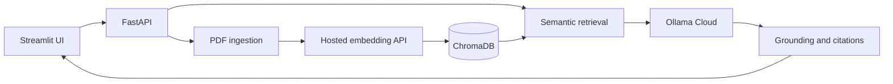

<div align="center">

# RAGShield

### Document intelligence. RAG security evaluation.

An end-to-end application for cited PDF question answering and controlled retrieval-poisoning experiments, developed from internship research.

[](https://github.com/Daredevil1915/RAGShield/actions/workflows/ci.yml)
[](https://www.python.org/)
[](https://fastapi.tiangolo.com/)
[](https://streamlit.io/)

[Overview](#overview) &nbsp;?&nbsp; [Quick start](#quick-start) &nbsp;?&nbsp; [Deployment](docs/DEPLOYMENT.md) &nbsp;?&nbsp; [Research](docs/RESEARCH.md)

</div>

---

## Overview

RAGShield connects a document question-answering workflow with an experimental environment for studying RAG availability attacks. Users can explore evidence behind an answer, then investigate how an injected document changes retrieval and model behavior.

| Mode | Capabilities |
| --- | --- |
| **Document Q&A** | Upload PDFs, ask follow-up questions, filter the document library, and inspect answers with page-level citations. |
| **Security Research** | Compare clean and poisoned responses, inspect blocker retrieval, measure answer jamming, and export experiment results. |

The hosted application uses **Ollama Cloud for chat** and **OpenAI embeddings for semantic search**. Inference runs through cloud APIs, independently of the developer's computer.

## Key features

- **Evidence-backed answers** ? document and page references with expandable source passages.
- **Grounding checks** ? relevance filtering and lexical checks to flag unsupported responses.
- **Document management** ? content-based duplicate detection, search filters and indexed-document deletion.
- **Controlled experiments** ? isolated research collections with blocker cleanup after each run.
- **Transparent evaluation** ? separate reporting for retrieval success and answer jamming.
- **Deployment support** ? Render Blueprint, process supervision, environment-based configuration and automated CI.

## Architecture



The research module uses a separate experimental collection to compare the clean pipeline with a poisoned version. Shared model adapters support Ollama Cloud and OpenAI-compatible APIs.

**Stack:** Python ? FastAPI ? Streamlit ? LangChain ? ChromaDB ? PyPDF ? Ollama Cloud ? OpenAI API

## Quick start

**Requirements:** Python 3.12, an Ollama Cloud API key and an OpenAI API key.

```bash
git clone https://github.com/Daredevil1915/RAGShield.git
cd RAGShield
python -m venv .venv
```

Activate the environment with `.venv\Scripts\activate` on Windows or `source .venv/bin/activate` on macOS/Linux, then:

```bash
pip install -r requirements-app.txt
cp .env.example .env
```

Set `OLLAMA_API_KEY` and `OPENAI_API_KEY` in `.env`, then start the application:

```bash
python scripts/start_render.py
```

Open **http://localhost:10000**. Upload a text-based PDF to begin, or switch to Security Research and prepare the demo corpus.

For hosted setup, follow the **[Render deployment guide](docs/DEPLOYMENT.md#deploy-on-render)**. Provider alternatives, environment settings and storage configuration are documented there.

## Research context

The project studies **availability attacks on RAG systems** using black-box blocker optimization and adversarial suffix methods. Its central distinction is that **a retrieved blocker does not necessarily jam an answer**.

The hosted research demo contains 64 MS-MARCO passages. It demonstrates the experimental workflow; it does not reproduce the original 50,024-passage benchmark. Grounding checks are heuristic and do not guarantee factual correctness or prompt-injection resistance.

See **[Research methodology and evaluation](docs/RESEARCH.md)** for experimental definitions, corpus scope and reproduction requirements.

## Testing

```bash
python -m pytest
```

The suite covers PDF processing, vector retrieval, API and UI flows, cloud adapters, provider failures and research cleanup. Tests use deterministic model substitutes and run in GitHub Actions on Linux with Python 3.12.

## Project structure

```text
app/                 API, ingestion, retrieval and cloud model adapters
ui/                  Document Q&A and research interfaces
suffix_attack/       Adversarial suffix generation and jamming evaluation
examples/            Demonstration corpus
scripts/             Application startup and process supervision
evaluation/          Golden questions and evaluation runner
tests/               Automated tests
docs/                Deployment and research documentation
bbo_attack.py        Black-box blocker optimization
rag_utils.py         Shared model and text-processing utilities
render.yaml          Render service configuration
```
